# Z-Image vs Qwen-Image 2.1 对比

两者都来自阿里，但**不是同一条产品线、也不是升级关系**，而是两种定位不同的开源生图模型：
- **Z-Image**（通义 Tongyi-MAI）：轻量、极速、**Apache 2.0 可商用**，纯文生图。
- **Qwen-Image 2.1**（Qwen 团队）：统一生成+编辑、**原生透明 PNG**、2K，Qwen Research License（商用需授权）。

> 本文档的"文字评价"只基于可验证的模型特性与本仓库实测数据，不含主观画质打分。样图见本仓库 `assets/`：Qwen 为 `<scene>_seed<n>.png`，Z-Image 为 `zimage_<scene>_seed<n>.png`，同场景同 seed 可直接并排对比。

## 规格对比

| 维度 | Z-Image | Qwen-Image 2.1 |
|---|---|---|
| 团队 | 通义 Tongyi-MAI | Qwen |
| 发布 | Turbo 2025-11 / Base 2026-01 | 2026-09-20（+Turbo 2026-10） |
| **许可证** | **Apache 2.0 ✅ 可商用** | Qwen Research ❌ 商用需授权 |
| 参数量 | 6B（S3-DiT 单流扩散 Transformer） | 7B 生成器 + 8B 文本编码器 |
| 架构 | Single-Stream DiT | Single-Stream DiT + Qwen3-VL 编码器 |
| 显存 | 16GB 消费卡可跑 | BF16 ~30GB / FP8 16GB |
| 原生透明 RGBA | ✗ 无 | ✓ 招牌能力 |
| 图像编辑 | ✗（基础 Img2Img/ControlNet 有，但非多参考编辑） | ✓ 最多 10 张参考图 |
| 最大分辨率 | 1024 级（可放大） | 原生 2K |
| 双语文字 | ✓ 中英 | ✓ 中文尤强 |
| 宣传速度 | Turbo 亚秒级 @1024²（H800，8 步） | Turbo 约数秒 |

## 本仓库实测（同一台 ap-northeast-1 g6e.xlarge / L40S 46GB，BF16）

同样 5 个场景、同样 prompt、同样 4 个 seed，两模型各出 20 张：

| 指标 | Z-Image-Turbo | Qwen-Image-2.1-Turbo |
|---|---|---|
| 平均耗时/张 | **~13.3 s** | **~6.4 s** |
| 采样步数 | 8 | 8 |
| 样图数 | 20 | 20 |

> ⚠️ **实测反差说明**：Z-Image 宣传"亚秒级"，但本次实测反而比 Qwen Turbo 慢。原因：(1) 我们跑的是竖版 1024×1408 等较大尺寸，而"亚秒级"基准是 1024² 方图 + H800 + 厂商优化内核；(2) diffusers 通用路径未启用 Z-Image 的专用加速。**结论：别照搬营销数字，按你的真实尺寸/硬件实测为准。** 在 1024² 小图 + 消费卡本地场景，Z-Image 的低显存优势才会体现。

## 人物特写专项对比（3 个场景）

额外补充 3 个**纯人物特写**场景（持小白鸟/棕色饰品棚拍/高马尾米色毛衣），两模型各 4 seed，共 24 张：
- 场景 id：`portrait_bird` / `portrait_jewelry` / `portrait_ponytail`
- 样图：Qwen `portrait_*_seed*.png`，Z-Image `zimage_portrait_*_seed*.png`（同场景同 seed 并排）

| 指标 | Z-Image-Turbo | Qwen-Image-2.1-Turbo |
|---|---|---|
| 平均耗时/张（人物特写，1024×1408） | ~13.2 s | ~6.4 s |
| 出图成功率 | 12/12 | 12/12 |

两模型都擅长写实人像；人物特写这类**无复杂排版文字**的场景，正是 Z-Image 的主场（Apache 2.0 可商用是决定性优势）。装饰边框/桃花角标两者都能渲染但不保证像素级精确，视为氛围元素。选型仍回到那条铁律：**要透明/编辑/2K → Qwen；要可商用/低成本纯文生图 → Z-Image。**

## 怎么选

| 你的情况 | 选 |
|---|---|
| 需要**商用**、无法走授权流程 | **Z-Image**（Apache 2.0）|
| 需要**原生透明 PNG**（贴纸/UI/抠图）| **Qwen-Image 2.1** |
| 需要**图像编辑 / 多参考图融合** | **Qwen-Image 2.1** |
| 需要 **2K 高分辨率** | **Qwen-Image 2.1** |
| **消费级 16GB 显卡**本地跑、纯文生图 | **Z-Image** |
| 中文海报 / 双语文字 | 两者都强，按商用需求定 |

## 一句话
- **Z-Image = 可商用 + 轻量**，补上了 Qwen-Image 2.1 "不能免费商用" 的缺口；
- **Qwen-Image 2.1 = 透明 + 编辑 + 2K**，这三样 Z-Image 做不到。
- **文字渲染各有短板（Turbo 与完整模型实测一致）**：**中文长词/标语 Qwen 更准**（Z-Image 把"海南儋州米兰"和"欢迎品尝"写错），**英文品牌词 Z-Image 更准**（Qwen 把"LANCÔME"写成仿字）。升到完整模型（40/30 步 + cfg≈4）改善了清晰度但**没改变谁对谁错**（见 [full-vs-full 复核](#完整模型档位复核full-vs-full)）。**凡是文字类商业稿，两者都需人工校字或后期叠真字，不能直接交付。**
- 对纯文生图的广告图：优先 Z-Image（可商用）；需要透明/编辑/2K 时用 Qwen。

## 样图对比（同 prompt · 同 seed=11）

每行左为 **Qwen-Image 2.1**，右为 **Z-Image**，均 seed=11、BF16、**8 步**。两侧**同为 Turbo 档**（Qwen-Image-2.1-Turbo vs Z-Image-Turbo），同 prompt、同 seed、同尺寸——apple-to-apple。完整 8 场景 × 4 seed 的全部样图见仓库 [`assets/`](../assets/)；两个文字争议场景的"完整模型档"复核见下方 [full-vs-full 小节](#完整模型档位复核full-vs-full)。

### 场景1 · 悬浮夹心烤面包
| Qwen-Image 2.1 | Z-Image |
|---|---|
|  | 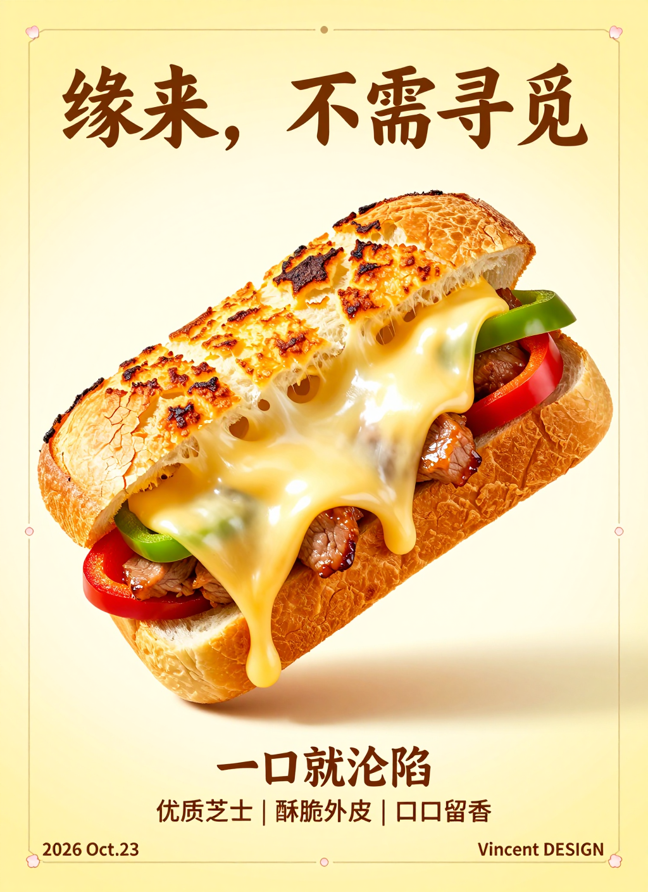 |

### 场景2 · 兰蔻精华水动态广告
| Qwen-Image 2.1 | Z-Image |
|---|---|
|  | 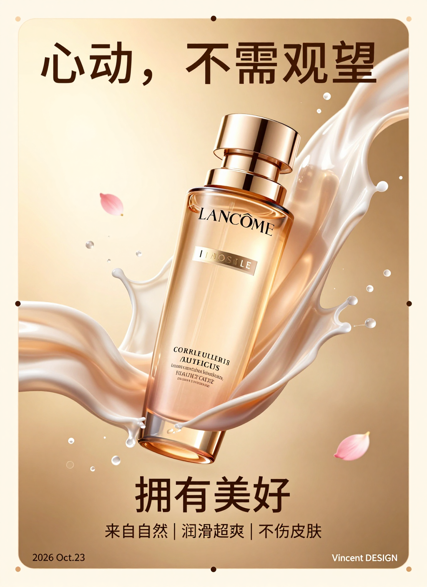 |

> 🔎 **观察（Turbo 档）**：瓶身**品牌英文名** Qwen-Image 2.1 写错（自造仿字，非 "LANCÔME"），**Z-Image 正确**。本例中英文品牌词 Z-Image 更可靠。**此结论在完整模型上同样成立**——见下方 [「完整模型档位复核（full-vs-full）」](#完整模型档位复核full-vs-full)。

### 场景3 · 海南儋州米兰（国潮）
| Qwen-Image 2.1 | Z-Image |
|---|---|
| 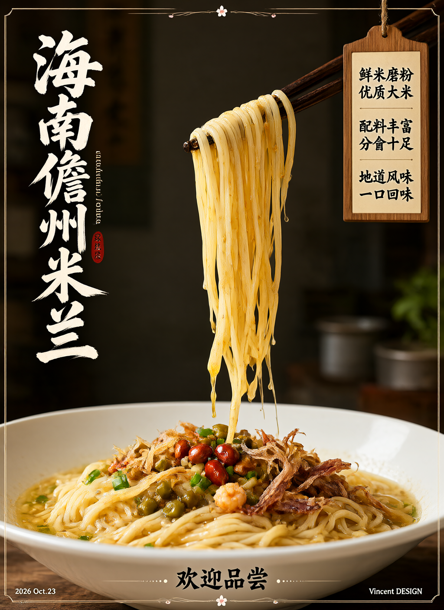 |  |

> 🔎 **观察（Turbo 档）**：**中文长词/标语** Z-Image 出错——竖排主标题"海南儋州米兰"有误（如"海南偷米林"），底部"欢迎品尝"出现错别字（如"欢迎晤尝"）；**Qwen-Image 2.1 的中文准确**。本例与场景2 相反：中文排版 Qwen 更强，英文品牌词 Z-Image 更强。**此结论在完整模型上同样成立**——见下方 [「完整模型档位复核（full-vs-full）」](#完整模型档位复核full-vs-full)。

### 场景4 · 人物三视图（角色设定）
| Qwen-Image 2.1 | Z-Image |
|---|---|
|  |  |

### 场景5 · 居家休闲人像
| Qwen-Image 2.1 | Z-Image |
|---|---|
| 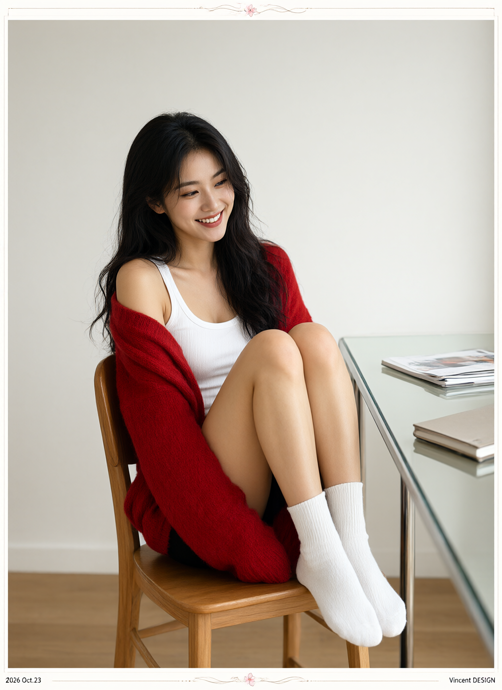 |  |

### 人物特写1 · 持小白鸟
| Qwen-Image 2.1 | Z-Image |
|---|---|
| 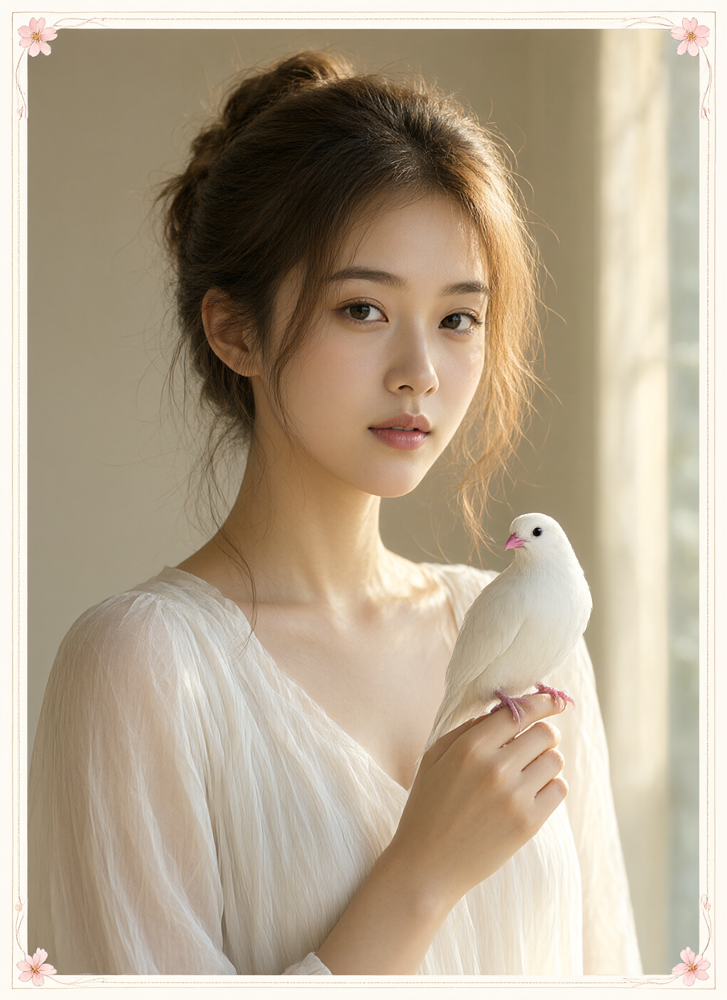 |  |

### 人物特写2 · 棕色饰品棚拍
| Qwen-Image 2.1 | Z-Image |
|---|---|
| 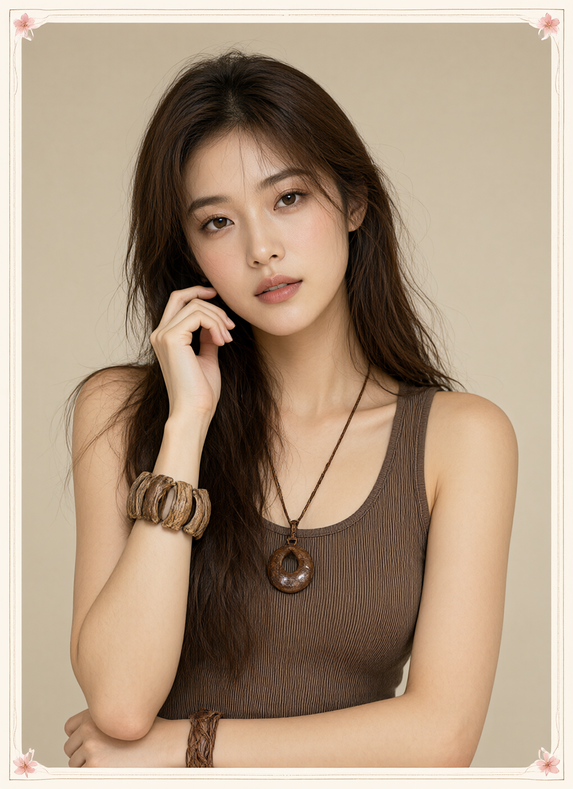 | 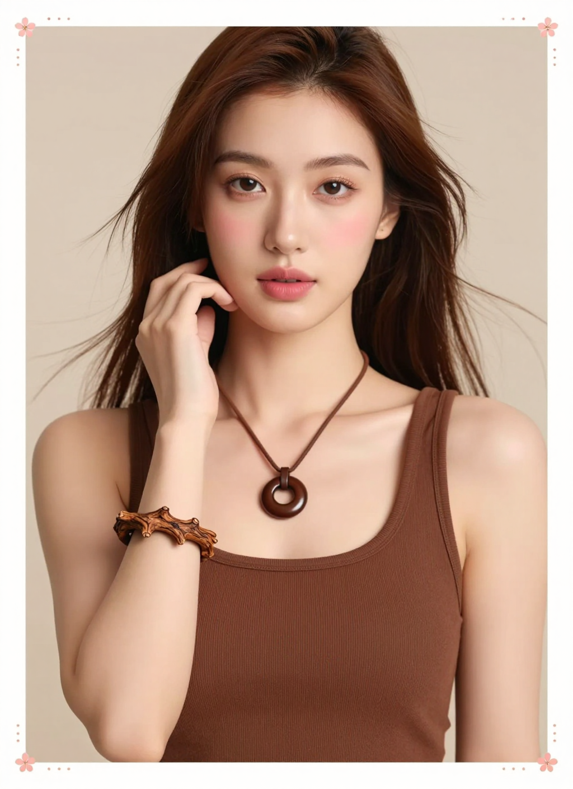 |

### 人物特写3 · 高马尾米色毛衣
| Qwen-Image 2.1 | Z-Image |
|---|---|
| 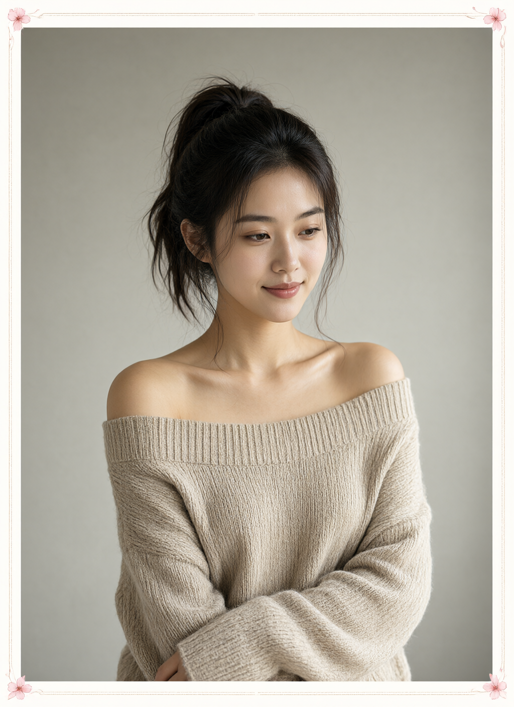 |  |

> 观察要点：文字/排版类场景（场景1-3）看中文标题与装饰边框的准确度；人物类看面部、发丝、光影与姿态自然度。图是同 seed 的单次采样，非精选，仅作直观参考；换 seed 结果会变。

## 完整模型档位复核（full-vs-full）

上面的样图对比是 **Turbo vs Turbo**（8 步，apple-to-apple）。有人会问："Turbo 文字糊，换成完整模型（更多步数 + cfg≈4）是不是就不糊了？" 为此我们把两个有文字争议的场景（兰蔻 / 海南儋州米兰）**两个模型都升到完整档**重跑，**同 seed（11/22/33/44）、同尺寸 1024×1408、同 BF16**，做一次严格的 full-vs-full 复核。

> 档位（已锁定，见 `scripts/gen.py`）：**Qwen-Image-2.1 完整** = 40 步 / `true_cfg_scale=4.0`（~50 s/张）；**Z-Image 完整** = 30 步 / `guidance_scale=4.0`（~47 s/张）。下面每张均取各自 4 seed 中**文字最准的一张**。

### 复核场景A · 兰蔻（英文品牌词）
| Qwen-Image 2.1 完整（40步） | Z-Image 完整（30步） |
|---|---|
| 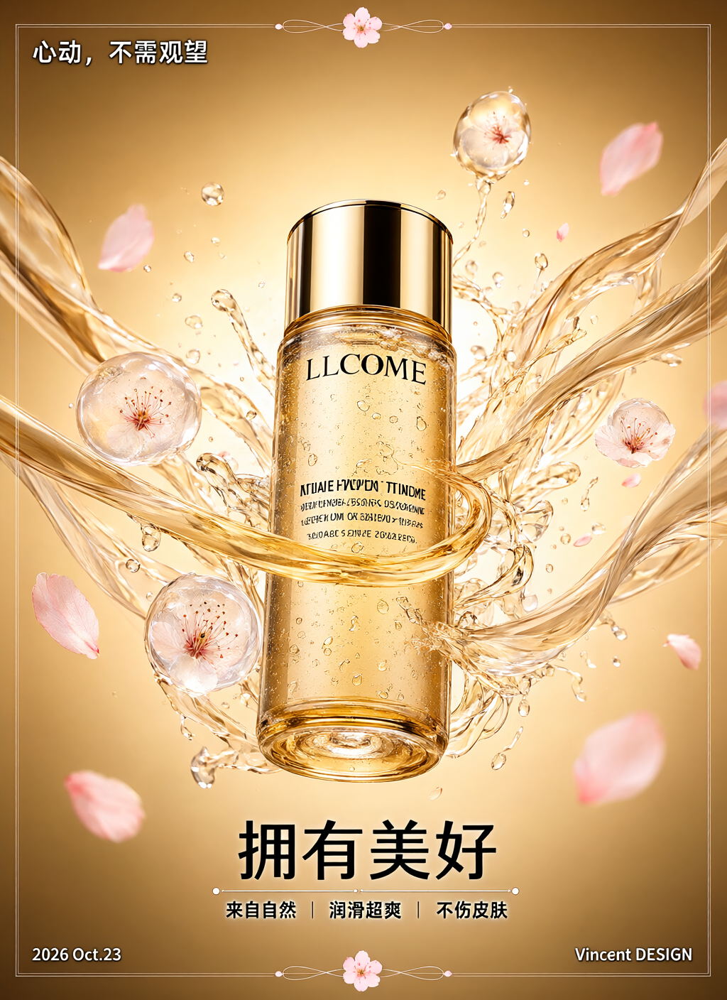 | 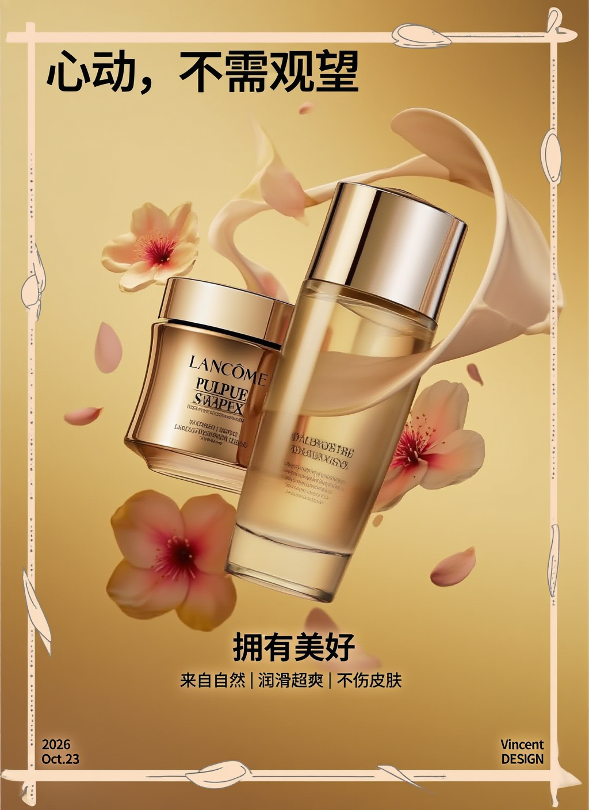 |

> 🔎 **结论**：**升到完整模型也救不了 Qwen 的英文品牌词**——4 个 seed 瓶身分别写成 `LLCOME / LLOCOME / LLOCOME / LLCOME`，无一正确。**Z-Image 完整正确渲染 "LANCÔME"**（含 ô，seed 33 最干净）。英文品牌词 Z-Image 胜，与 Turbo 档一致。

### 复核场景B · 海南儋州米兰（中文长词）
| Qwen-Image 2.1 完整（40步） | Z-Image 完整（30步） |
|---|---|
| 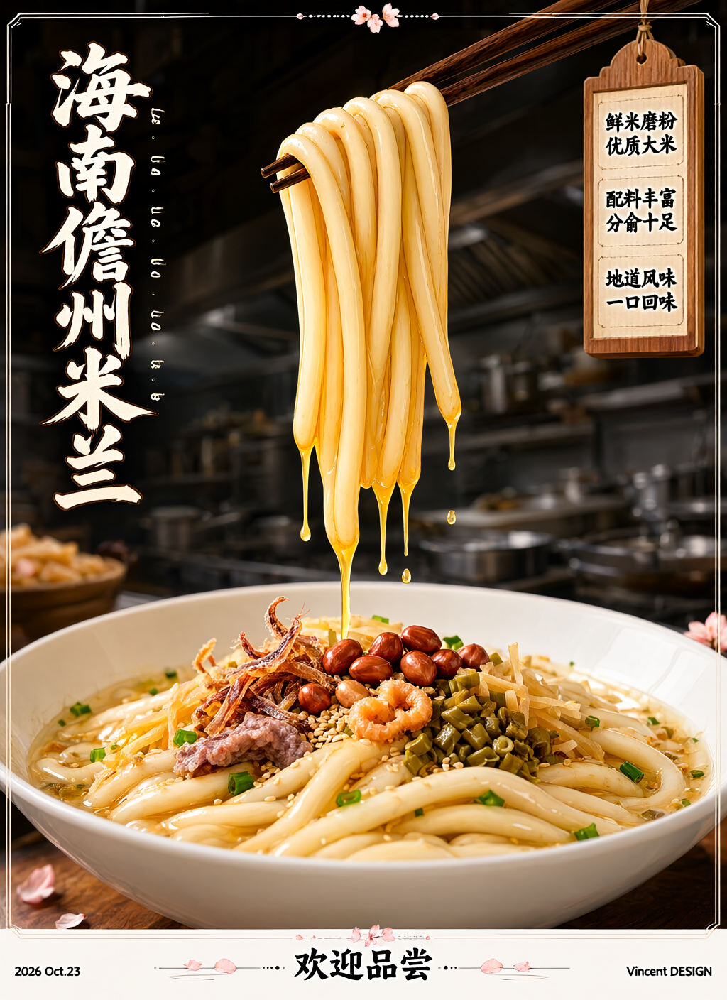 | 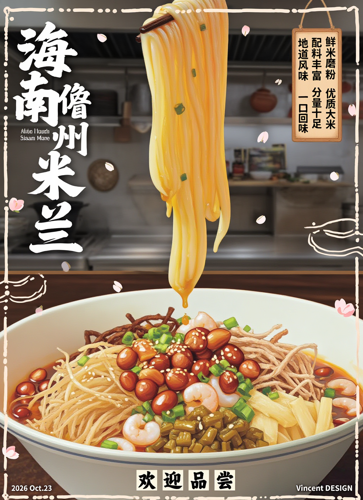 |

> 🔎 **结论**：**升到完整模型也救不了 Z-Image 的中文长标题**——4 个 seed 竖排主标题分别糊成"海潮米兰 / (乱码) / (乱码) / 海借…"，均不正确（底部"欢迎品尝"倒是都对了）。**Qwen 完整正确渲染"海南儋州米兰"+"欢迎品尝"**（seed 33；木牌小字"分量"仍误作"分俞"，属次要副文）。中文长词 Qwen 胜，与 Turbo 档一致。

### 复核小结
| 文字类型 | Turbo 档结论 | 完整档结论 | 是否一致 |
|---|---|---|---|
| 英文品牌词（LANCÔME） | Z-Image 准，Qwen 错 | Z-Image 准，Qwen **仍**错 | ✅ 一致 |
| 中文长标题（海南儋州米兰） | Qwen 准，Z-Image 错 | Qwen 准，Z-Image **仍**错 | ✅ 一致 |

**所以"换完整模型就能修好文字"并不成立**：各自的文字短板是**模型能力级**的，提高步数 / cfg 改善了清晰度与画质，但**没有改变谁对谁错**。结论依旧那句铁律——**文字类商业稿两者都必须人工校字或后期叠真字，不能直接交付**；选型时按主文字语种选（英文品牌→Z-Image，中文长标语→Qwen）。全部复核样图见 [`assets/fix/`](../assets/fix/)。

## 复现
```bash
# —— Turbo 档（样图对比用）——
# Z-Image : ZImagePipeline, Tongyi-MAI/Z-Image-Turbo , 8 步 , guidance_scale=1.0
# Qwen    : QwenImage21Pipeline, Qwen/Qwen-Image-2.1-Turbo , 8 步 , true_cfg_scale=1.0
# —— 完整档（full-vs-full 复核用）——
# Z-Image : ZImagePipeline, Tongyi-MAI/Z-Image , 30 步 , guidance_scale=4.0
# Qwen    : QwenImage21Pipeline, Qwen/Qwen-Image-2.1 , 40 步 , true_cfg_scale=4.0
# 两档均 BF16 on L40S；参数锁定在 scripts/gen.py，prompts 见 tests/prompts.jsonl
# 例：python scripts/gen.py --model qwen-full --only cosmetic_lancome_essence,food_hainan_milan --seeds 11,22,33,44 --out assets/fix/ --prefix qwenfull
```
