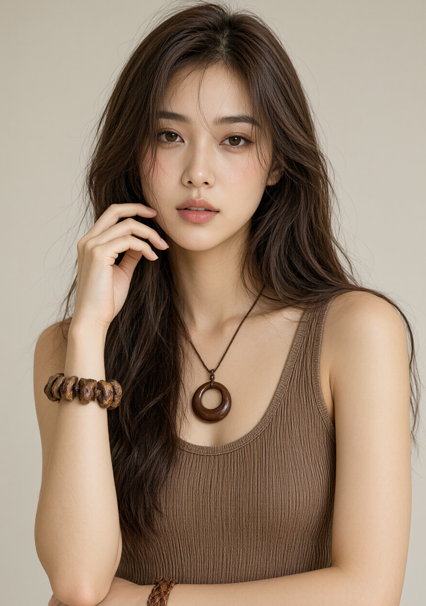
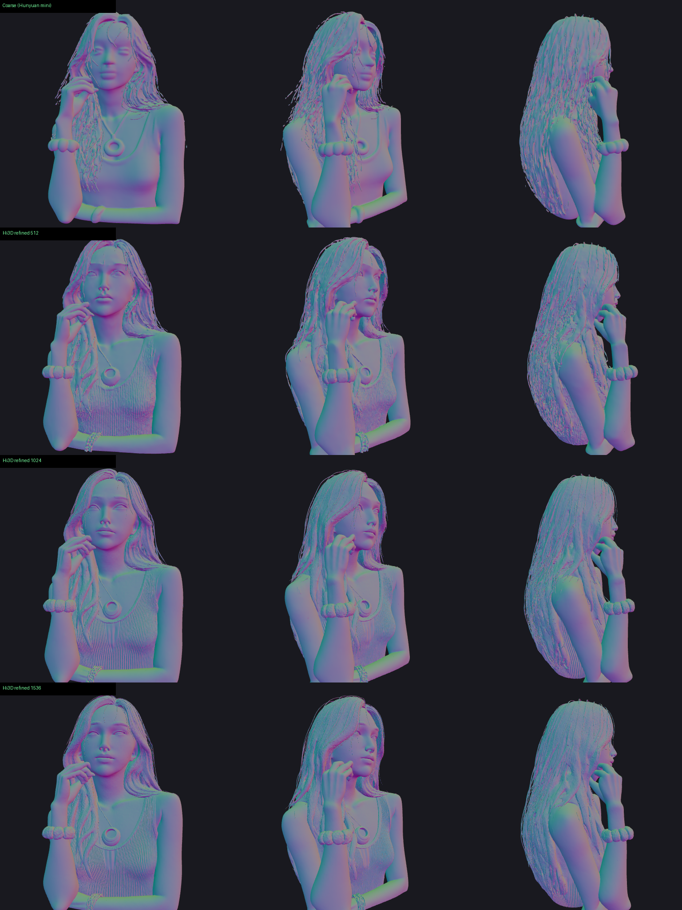
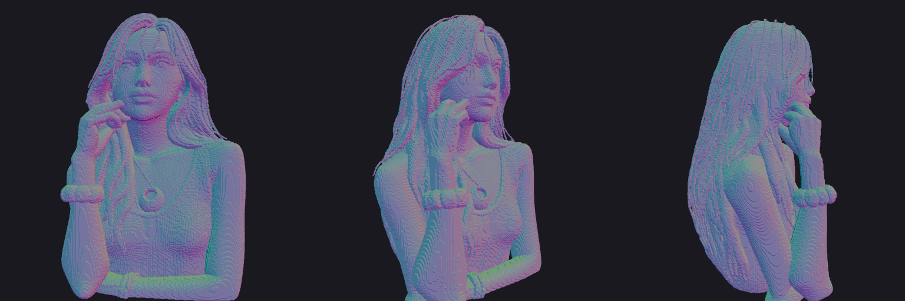
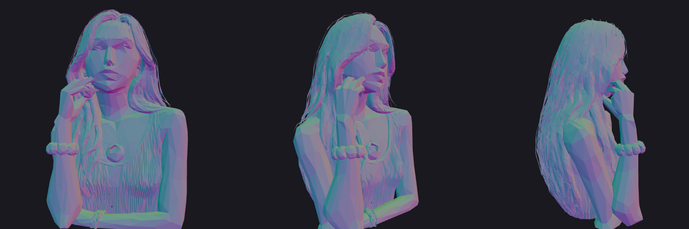
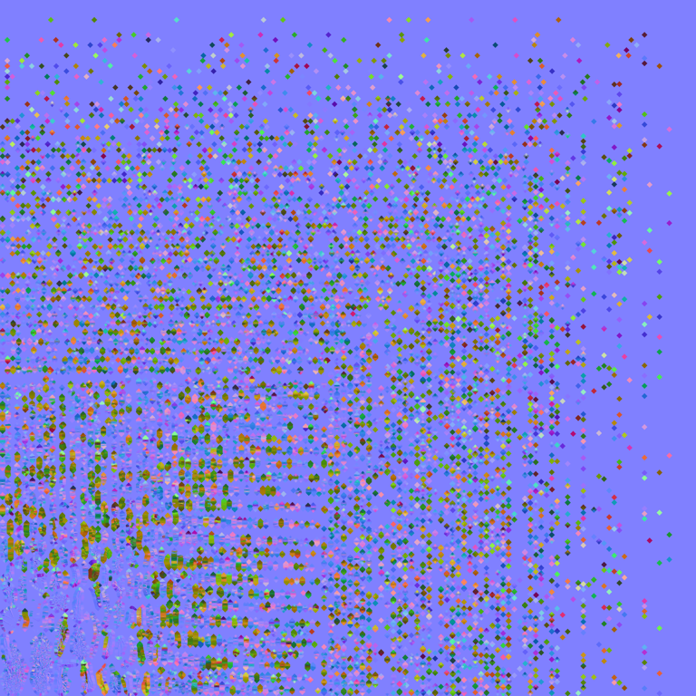
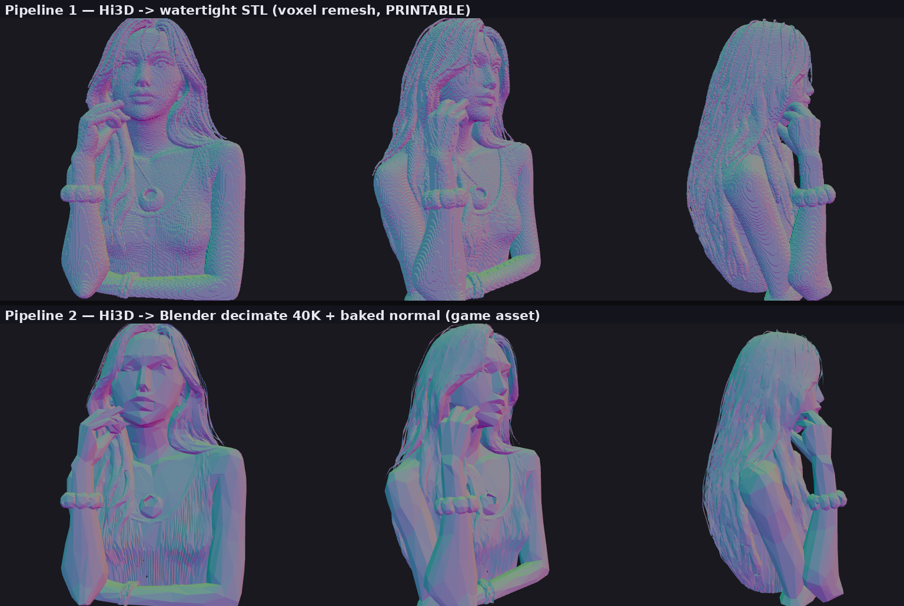
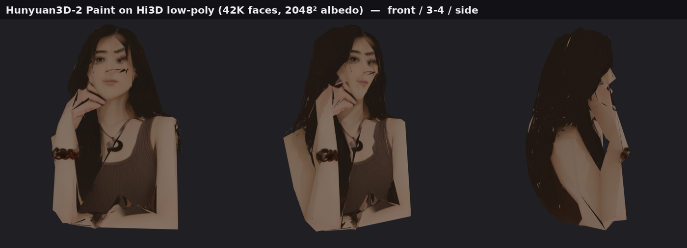
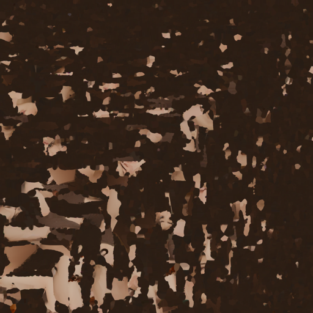

# Hi3D v1.0 (Sparc3D) 实测评估：图→3D 几何细化

> 模型：[hi3d-official/Hi3Dv1.0](https://huggingface.co/hi3d-official/Hi3Dv1.0) ·
> [GitHub](https://github.com/hi3d-official/Hi3Dv1.0) ·
> [在线 Space](https://huggingface.co/spaces/ilcve21/Sparc3D) ·
> 论文 [Sparc3D arXiv:2505.14521](https://arxiv.org/abs/2505.14521)
> 许可：Hi3D Open License 1.0（商用可，有 MAU/营收阈值 + `Powered by Hi3D 1.0` 标注要求）

## 一句话结论

Hi3D v1.0 **不是文生图模型**，而是一个 **“粗网格 → 高精度几何”的 3D 细化模型**（image-to-3D geometry
refinement，**只出几何，不出纹理/颜色**）。它本身不能从一张图直接出 3D，需要一个上游“粗生成器”先出 coarse
mesh——官方 demo 用 **Tencent Hunyuan3D-2 mini** 充当这个角色。实测在 **48GB L40S** 上配
`sequential_cpu_offload` 可以跑通 **512 / 1024 / 1536 全部三档**，**完全不需要官方建议的 96GB H20**。

## 和 Qwen-Image / Z-Image 的区别

| | Qwen-Image / Z-Image | Hi3D v1.0 |
|---|---|---|
| 任务 | 文本 → 2D 图像 | 图 + 粗网格 → **高精度 3D 几何** |
| 输入 | 文本 prompt | 参考图 **+ coarse mesh（.glb）** |
| 输出 | PNG 图片 | **几何网格 .glb（无纹理/无颜色）** |
| 能否独立出 3D | — | **否**，需上游粗生成器（demo 用 Hunyuan3D-2 mini） |

对比图里的彩色是**表面法线渲染**（normal map），不是生成的贴图——Hi3D 明确声明 “Geometry only”。

## 系统/流水线

三档“分辨率阶梯”，逐级细化（每档一个 pass，高档包含前面所有 pass）：

| 请求分辨率 | passes | 名义结构网格 | 稀疏抽取网格 | 用到的 transformer |
|---|---|---|---|---|
| 512  | 1 | 64³  | 512³  | `transformer_512` |
| 1024 | 2 | 128³ | 1024³ | + `transformer_1024` |
| 1536 | 3 | 192³ | 1536³ | `transformer_1024` 再跑一轮 |

端到端：**参考图 →（Hunyuan mini 出 coarse mesh）→ Hi3D 逐 pass 细化 → refined.glb**。

## 实测硬件与可行性（关键发现）

官方实测栈是 **96GB NVIDIA H20**，并声明 1536³ 只在该卡验证过、更小卡“峰值显存与可行性未知”。
我们在 **东京 g6e.xlarge（NVIDIA L40S, 46GB 可用）** 上用 `--sequential-cpu-offload` 实测：

| 档位 | 结果 | 峰值显存 | 耗时* | 输出网格（顶点/面） | 文件大小 |
|---|---|---|---|---|---|
| 512  | ✅ 成功 | **5.1 GB** | ~588s（含首次下权重） | 495K / 1.0M | 18 MB |
| 1024 | ✅ 成功 | **15.6 GB** | ~500s | 496K / 1.0M（面数封顶 1M） | 18 MB |
| 1536 | ✅ 成功 | **14.7 GB** | ~642s | **997K / 2.0M** | 36 MB |

\* 耗时含 CPU offload 的换入换出开销（offload 用时间换显存）；512 那次额外含首轮权重下载。

**结论：48GB 的 L40S（~$1.86/hr）足以跑满 1536³ 全档，不需要大显存卡。** 官方 96GB 要求偏保守，
offload 模式下峰值显存只有 ~15GB。关掉 offload 会更快但显存占用更高（未测）。

## 实测效果（法线渲染，前 / 3-4 / 侧 三视图）

### 输入参考图


### 阶梯对比：Coarse → 512 → 1024 → 1536
从上到下：Hunyuan 粗网格 → Hi3D 512 → 1024 → 1536。


逐档观察：
- **Coarse（Hunyuan mini）**：轮廓/项链吊坠/手镯/发丝大形已经不错，但表面偏平滑、发丝成块。
- **Hi3D 512**：发丝出现条状起伏，**针织背心出现罗纹织物纹理**，手镯珠子分明，五官更清晰。
- **Hi3D 1024**：发丝更锐利、流向更细；罗纹更规整、下摆针织成形；五官更精细。
- **Hi3D 1536**：发丝细到单根纤维级（侧视最明显）；罗纹锐利规整；2M 面带来最高几何密度。

细化是**真·逐级增加几何细节**，不是简单平滑——印证了官方“high-resolution geometry refinement”的说法。

## 复现

环境（L40S / DLAMI，Python 3.10）：

```bash
# 1) Hi3D 本体（锁定内核栈）
git clone https://github.com/hi3d-official/Hi3Dv1.0.git && cd Hi3Dv1.0
python3.10 -m venv .venv && . .venv/bin/activate
pip install torch==2.5.0+cu124 torchvision==0.20.0+cu124 --extra-index-url https://download.pytorch.org/whl/cu124
pip install packaging ninja psutil
pip install --no-build-isolation flash-attn==2.7.4.post1
pip install -c docker/constraints.txt -e ".[inference]"
pip install -c docker/constraints.txt -e ".[demo]" onnxruntime   # rembg 去背景

# 2) 上游粗生成器 Hunyuan3D-2 mini（第三方，另装）
cd .. && git clone https://github.com/Tencent-Hunyuan/Hunyuan3D-2.git
echo "$PWD/Hunyuan3D-2" > "$(python -c 'import site;print(site.getsitepackages()[0])')/hunyuan.pth"
pip install einops opencv-python-headless pymeshlab scikit-image tqdm pyyaml xatlas
```

**依赖冲突修复（重要）**：Hunyuan 会把 `diffusers` 顶到 0.41.0，在 torch 2.5 上报
`torch.accelerator` 缺失；需锁 **`diffusers==0.31.0` + `huggingface-hub==0.28.1`**
（同时满足 sparc3d `>=0.28,<1` 和 transformers 4.46.3 的 `<1.0`）。transformers 保持 Hi3D 锁定的
4.46.3（hy3dgen 虽警告要 `>=4.48`，但非致命）。

**首次运行坑**：Hi3D 的 loader 拒绝 HF 缓存里的符号链接；需把
`~/.cache/huggingface/hub/models--hi3d-official--Hi3Dv1.0/snapshots/*/` 下的所有 symlink 解引用为实体文件
（或下载时禁用 symlink）。否则 1024/1536 报 `model repository has an unexpected symlink`。

端到端跑一张图：

```bash
python demo/image_to_mesh.py \
  --model hi3d-official/Hi3Dv1.0 \
  --image input.png --output refined.glb --coarse-output coarse.glb \
  --resolution 1536 --seed 0 --remove-background --sequential-cpu-offload
```

已有 coarse mesh 时只做细化（不依赖 Hunyuan）：`demo/refine_mesh.py --image ... --coarse-mesh coarse.glb ...`。

## 评价小结

- **优点**：几何细节是真的强（发丝/织物纹理/相对小的配件都能细化出来）；48GB 卡就能跑满 1536³，门槛比官方宣称低很多；许可允许商用。
- **限制**：只出几何、无纹理/颜色；必须配上游粗生成器（demo 绑定 Hunyuan3D-2 mini，依赖冲突需手工解）；offline 还要本地化 DINOv2/CLIP/Hunyuan；隐藏面是“合理补全”不是真实重建；输出做了归一化，不保留原始世界坐标/绝对尺度。
- **适用**：已有/能生成粗网格、需要把它细化到可用于渲染或打印的高精度几何的场景。

---

## 如何落地到实际业务场景

最关键的一点决定一切适配度：**Hi3D v1.0 只出几何（mesh），不出纹理/材质/颜色/UV/骨骼**。它是“细化器”，
不是完整资产生成器。所以能不能落地，取决于你的业务对“裸几何”的接受度，以及后面还要补多少工序。

| 场景 | 适配 | 关键缺口 / 需补工序 |
|---|---|---|
| **3D 打印手办/原型/摆件** | ✅ 直接可用 | 打印前补**水密化 + 补洞 + 底座/支撑**；可注塑**模具**（分型面/拔模角）仍需 CAD |
| **游戏/视频可动资产** | ⚠️ 只替代“出高模”一步 | 缺 UV/PBR 贴图/低模/骨骼——后续 **retopo → UV → 烘焙 → 绑定** 仍靠 Blender |
| **静帧渲染/概念草模/电商 AR 展示** | ✅ 较好 | 要展示效果需补贴图（可接 Hunyuan3D-2 paint 模块） |
| **文物/实物数字化存档** | ✅ 最省事 | 只要几何的场景无额外缺口 |

### 1. 3D 打印模具 / 手办 —— 最契合
3D 打印本来就**只吃几何**（STL/mesh），不需要贴图材质——Hi3D 的输出正好是打印机要的东西。
流程：参考图 → Hunyuan 出粗网格 → Hi3D 细化到 1536³ → 导出转 STL → 切片打印。
1536³ 的表面细节（发丝、织物罗纹、五官）足够手办/摆件级别。
**但**：打印前仍要做网格修复/水密化（manifold 检查、补洞），注塑**模具**本身是另一套 CAD 工作，
Hi3D 只给“原型几何”，不给可注塑的模具。→ 本文档 [附录 A](#附录-ahi3d--stl-可打印流程实测) 有端到端实测。

### 2. 3D 游戏 / 视频素材（替代部分 Blender 建模）—— 半程可用，不能直接进引擎
能帮你**省掉“从零 box-modeling / sculpt 高模”这一段**，但**不能直接当游戏资产**，原因：
- **缺纹理/UV/材质**：游戏/渲染资产必须有 UV + PBR 贴图，Hi3D 一概不给 → 仍要在 Blender 里 UV 展开 + 烘焙 + 画 PBR（或用 Hunyuan3D-2 paint、Substance）。
- **面数太高 + 三角汤拓扑**：2M 面、非规则拓扑**不能直接进引擎**（实时渲染要低模 + 干净拓扑）。要 **retopology + 减面 + 把高模细节烘成法线贴图**。
- **无骨骼/动画**：角色要动还得绑骨骼蒙皮。

正确定位：Hi3D = **“AI 出高模原型”替代手工雕高模那一步**，后面 retopo→UV→贴图→绑定仍在 Blender 完成。
对静帧/概念验证/background prop 可用度更高；对主角/可动资产省的工序比例小。
→ 本文档 [附录 B](#附录-bhi3d-高模--blender-重拓扑烘焙游戏资产流程实测) 有端到端实测。

### 一句话判断
Hi3D 把“从图到高精度几何”这一步自动化了：**越是只要几何的业务（3D 打印）越直接能用；
越是要完整资产的业务（游戏），它只是管线里的一环，省不了 Blender 的后处理。**

---

## 附录 A：Hi3D → STL 可打印流程（实测）

脚本 [`scripts/hi3d/to_printable_stl.py`](../scripts/hi3d/to_printable_stl.py)：把 Hi3D 的
`refined_1536.glb` 转成切片机可用的**水密 STL**，并验证打印就绪性。

**关键发现：Hi3D 的原始网格不是打印就绪的。** 它是“三角汤”——大量非流形边 + 开口洞 +
上千个游离碎片。单纯补洞/修流形会在两者之间反复横跳（补了洞又因删非流形面而破洞）。
**对 AI 生成网格做打印准备，业界标准做法是体素重网格（voxel remesh）**——用 marching cubes
从体素场重建，**天然得到水密 + 2-manifold 的实体**。脚本先尝试轻量拓扑修复，不达标则自动回退体素重网格。

实测（输入 = 1536³ refined.glb）：

| 指标 | 修复前（Hi3D 原始） | 修复后（体素重网格） |
|---|---|---|
| 水密 watertight | ❌ false | ✅ **true** |
| 是实体 is_volume | ❌ false | ✅ **true** |
| 开口边（洞） | 285 | **0** |
| 连通块 | **1436**（碎片） | **1** |
| 顶点 / 面 | 997K / 2.0M | 501K / 1.0M |
| **判定** | — | ✅ **PRINTABLE** |



水密实体的法线渲染（前/3-4/侧）。可见体素重网格带来的轻微**阶梯纹理**（侧面/背面最明显）——
这是“保证水密”的代价；`target_long_axis_voxels`（默认 320）越高阶梯越细、文件越大。脸、项链吊坠、
手镯、发丝大形都保留得足够做手办级打印。

**落地注意**：① 输出 bbox 是**归一化/体素单位**（例：221×321×166），实际打印前要在切片软件里
**缩放到真实毫米**；② 需要**底座/支撑**（切片软件生成）；③ 注塑**模具**（分型面/拔模角/缩水率）是
另一套 CAD 工作，Hi3D 只给“原型几何”。

跑法：`python scripts/hi3d/to_printable_stl.py refined_1536.glb figurine.stl print_report.json`

---

## 附录 B：Hi3D 高模 → Blender 重拓扑 + 烘焙贴图（游戏资产流程，实测）

脚本 [`scripts/hi3d/blender_retopo_bake.py`](../scripts/hi3d/blender_retopo_bake.py)：Blender 4.2 LTS
**无头**（`--background`）运行，把 Hi3D 高模变成**游戏可用的低模 + 法线/AO 贴图**。

流程：导入高模（2M 面）→ 复制并 **decimate 到低模** → **Smart UV 展开** →
**Cycles GPU 把高模的 NORMAL + AO 烘到低模 UV**（selected-to-active）→ 导出低模 `.glb`（法线贴图已接入）+ 独立 PNG。

实测（输入 = 1536³ refined.glb）：

| 指标 | 值 |
|---|---|
| 高模面数 | 1,998,806 |
| 低模面数 | **40,000**（decimate ratio 0.02，↓50×） |
| UV 展开 | ✅ Smart UV |
| 烘焙 | NORMAL + AO，2048×2048，Cycles GPU |
| 输出 | `low_poly_baked.glb` + `normal.png` + `ao.png` |



40K 面低模（法线渲染）：轮廓完整、无破洞，脸/发/项链/手镯/手指都在，可见低模特有的**多边形刻面**。



烘出的切线空间**法线贴图**：下半部（衣物针织/发丝）有明显结构细节，上半部偏蓝是因为低模在那里
已贴近高模（delta 小 = 法线更接近 0,0,1），属正常——法线贴图补的正是低模几何扛不住的**表面微结构**。

**踩坑（已修进脚本）**：烘焙 cage 距离**必须随模型尺度缩放**。初版硬编码 `cage_extrusion=0.05`，
而模型 bbox ~1.2×1.7×0.9，cage 太小导致射线打不到高模、法线图烘成一片平蓝（无细节）。
改成**按低模 bbox 对角线的 8%** 自适应（实测 cage≈0.18）后，细节正常传递。

**诚实的范围说明**：本脚本证明的是**可自动化**的那段（decimate + UV + 烘焙）。
`decimate` 是**自动重拓扑的替身**，不是干净四边形拓扑——出货资产通常仍要
手工 / ZRemesher 做 quad retopo；但**法线烘焙能让低模在光照下“看起来像”高模**，这一步 Hi3D 自己给不了。
另外**贴图只有几何派生的 normal/AO，没有 albedo/颜色**（Hi3D 无纹理）——要带色需接 Hunyuan3D-2 的 paint 模块或手绘。
→ 本文档 [附录 C](#附录-c给-hi3d-游戏低模补颜色贴图hunyuan3d-2-paint实测) 已把 Hunyuan Paint 补色端到端跑通。

跑法：`blender --background --python scripts/hi3d/blender_retopo_bake.py -- refined_1536.glb out_game 40000 2048`
（Blender 从官方 tarball 装，无需 sudo；无头烘焙还需 `libxxf86vm1 libxi6 libxrender1 libgl1` 等 X11/GL 运行库）。

### 两条流程一览



---

## 附录 C：给 Hi3D 游戏低模补颜色贴图（Hunyuan3D-2 Paint，实测）

承接附录 B：附录 B 的法线/AO 烘焙解决了“低模看起来像高模”，但**没有颜色**。这一步用
**Hunyuan3D-2 Paint（texgen）** 给几何补 **albedo 彩色贴图**——它从多视角渲染网格、用参考图做
视角一致的扩散、再把结果烘进 UV 贴图，得到**带色的 glb**。脚本 [`scripts/hi3d/paint_mesh.py`](../scripts/hi3d/paint_mesh.py)。

实测（输入 = `refined_1024.glb`，条件图 = 原始参考图）：

| 指标 | 值 |
|---|---|
| painter | `hy3dgen.texgen.Hunyuan3DPaintPipeline`（`hunyuan3d-paint-v2-0`，1.3B） |
| 上色网格 | **42,109 面**（见下方“关键坑”） |
| UV | ✅ 自带（75,782 uv 坐标） |
| albedo 贴图 | ✅ **2048×2048 RGB** baseColorTexture |
| 输出 | `painted_1024.glb`（3.9MB，带贴图） + `albedo_1024.png` |
| 上色耗时 | **221s**（权重已缓存时） |



彩色渲染（前 / 3-4 / 侧）：肤色、黑色长发、棕色针织背心、琥珀色串珠手镯、吊坠项链、五官都被
合理上色。**诚实的局限**：参考图是**正面单图**，所以**侧/背面信息少、偏暗**（单图 paint 的固有短板，
要全向更准需多视角参考图或手补）；低模 42K 面的**刻面**在轮廓处可见。



烘出的 2048² **albedo UV 图集**（碎片是 UV 展开后的纹理岛，正常）。

**关键坑（已修进脚本）**：直接把 Hi3D 的**原始高模（~100 万面、非流形“三角汤”）**喂给 paint 会
**卡死**——paint 的 UV 展开（xatlas）+ 栅格化烘焙是 **CPU 步骤**，在超密非流形网格上会无限自旋
（实测 **100% CPU / 0% GPU、显存冻结、9+ 小时零产出**）。修法：上色前先过 Hunyuan 自带的
`FloaterRemover + DegenerateFaceRemover + FaceReducer` **清理并减面到 ~40K**（这也正好对应“游戏低模”），
之后 paint 几分钟即完成。

跑法：`python scripts/hi3d/paint_mesh.py refined_1024.glb ref.png painted.glb 40000`
（需先装 texgen 的两个 CUDA 扩展 custom_rasterizer + differentiable_renderer，见 [`scripts/hi3d/paint_env.sh`](../scripts/hi3d/paint_env.sh)，
以及运行期 `xatlas / omegaconf / pygltflib`）。

**到此，游戏资产链路补齐**：Hi3D 出高精度几何 → Blender 减面 + UV + 法线/AO 烘焙 → Hunyuan Paint 补 albedo 彩色，
得到一个**带色 + 带法线、面数可控**的游戏可用资产。仍需的人工环节只剩 **quad retopo（可选）和骨骼绑定**。
