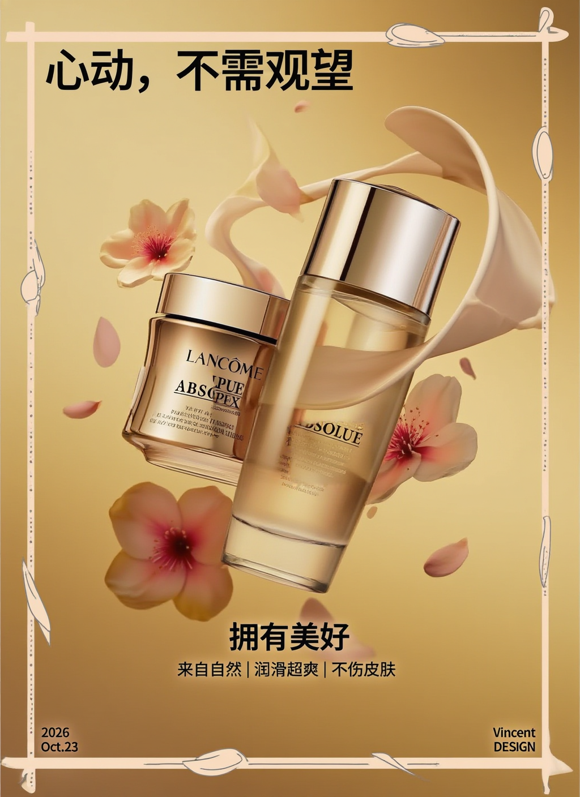
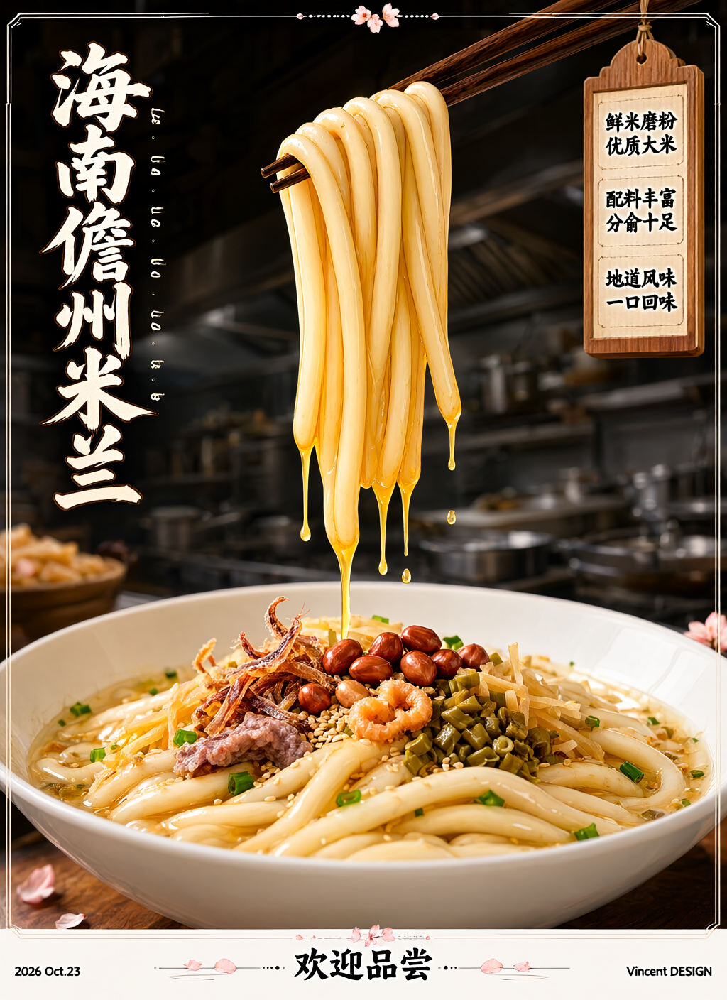
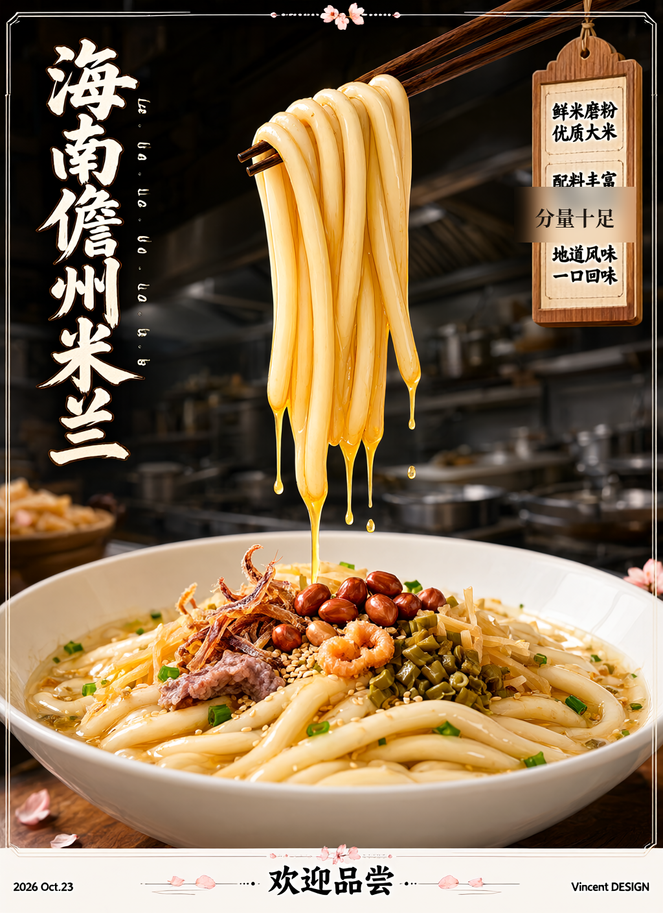

# 能不能"完善修复"文字错误？——ComfyUI / inpaint 与叠真字的实测

> 背景：`COMPARISON_zimage-vs-qwen-image-2.1.md` 的 full-vs-full 复核发现，即使升到完整模型，
> 两个模型各自仍有文字短板，而且"胜出"的一侧也只是某一处对、其余文字仍不可读：
>
> - **兰蔻场景（Z-Image full seed33）**：瓶身主标 `LANCÔME` 正确，但瓶身其余英文产品说明
>   （`PULPUE SAAPEX …` 等）完全是乱码、不可读。
> - **海南儋州米兰场景（Qwen-Image-2.1 full seed33）**：竖排主标「海南儋州米兰」正确，
>   但木牌上「分**俞**十足」把「量」写成了「俞」。
>
> 于是测试两条"修复"路径，看能否**完善**修好这些残留错误：
> **A＝叠真字（本地矢量文字覆盖）**、**B＝模型 inpaint（ComfyUI 生态里真正能改文字的手段）重绘文字区**。

## 结论（先说要点）

**换 ComfyUI 跑同一个模型不会修好文字——根因在模型权重，不在前端或采样器。**
而 ComfyUI 生态里**真正**能改文字的手段是 **inpaint / 文字区重绘**，这条路我们用 diffusers 的
同族 inpaint 管线直接实测了（ComfyUI 只是同一能力的另一个外壳）。实测结果：

| 路径 | 文字是否正确 | 在光滑瓶身上的融合 | 能否"完善修复" |
|---|---|---|---|
| **B：同模型 inpaint 重绘**（Z-Image inpaint，mask 瓶身文字区） | ❌ 仍乱码 | ✅ 文字贴合瓶身曲面/光影，自然 | **否** |
| **A：叠真字**（Pillow 矢量文字覆盖） | ✅ 完全正确 | ⚠️ 平面木牌干净；光滑瓶身上补丁痕迹可见 | 平面标签可；曲面瓶身需在设计软件里精修 |

一句话：**inpaint 让文字"贴得更自然"，但重绘出来的还是同一个模型拼不对的乱码**——
因为被 mask 的区域仍由那个"本来就拼不对"的模型重新生成。**叠真字**才能保证文字 100% 正确，
但在光滑曲面瓶身上要做到无痕，需要设计软件里的蒙版合成，而非一刀切的矩形补丁。

## B：模型 inpaint 实测（关键证据）

在东京 L40S 上用 `diffusers.ZImageInpaintPipeline`（`Tongyi-MAI/Z-Image`，30 步、cfg4、strength 0.95）
对兰蔻场景瓶身的两个乱码文字块打 mask 重绘（mask 见 `assets/fix/inpaint/lancome_mask.png`）：

- 结果（`assets/fix/inpaint/lancome_inpaint_s11/22/33.png`）：右瓶重绘出较清楚的 `ABSOLUE`，
  **文字随瓶身曲面/光影自然贴合**（这是平面叠字做不到的）——
- **但左罐仍出现 `ABSCPEX`／`PUE` 之类的乱码片段，下方小字依旧不可读。**
  即：inpaint 把乱码换成了"融合更好的新乱码"，**没有**真正拼对英文。

**实测效果图（兰蔻场景，左＝原图乱码，中＝mask，右＝inpaint 重绘后）：**

| 原图（Z-full seed33，瓶身英文乱码） | inpaint mask（白＝重绘区） | inpaint 重绘后（seed33） |
|:---:|:---:|:---:|
|  |  |  |

> 对比右两张瓶身文字区：重绘后文字确实**贴合瓶身曲面、融合更自然**，但放大看左罐仍是
> `ABSCPEX`/`PUE` 等**乱码**、下方小字不可读——模型没有把英文拼对。另见
> `lancome_inpaint_s11.png` / `lancome_inpaint_s22.png`，三个 seed 结论一致。

> Qwen-Image-2.1 侧：diffusers 0.41 的 `QwenImageInpaintPipeline` 需要 `tokenizer` 组件，
> 而 2.1 架构用的是 `processor`，二者**不兼容**，无法直接对 2.1 做 mask inpaint；
> 2.1 的编辑能力在独立的 `Qwen-Image-Edit` 模型里（另一套权重，已不是被测模型本身）。
> 这本身也说明：想让"这个模型"自己把字改对，并没有现成的同模型 inpaint 通路。

### 为什么 ComfyUI 换壳没用、它最新版还跑不起来

1. ComfyUI 只是运行**同一份权重**的另一个外壳；换采样器/步数/cfg 改的是清晰度与风格，
   **改不了模型学到的拼字能力**——这与 full-vs-full 复核（40/30 步 + cfg4 仍拼错）一致。
2. 本项目实测：当前 ComfyUI 最新版在这台机器上**根本起不来**——
   `comfy-kitchen 0.2.40` 的 `list[int]` 自定义 op 在 torch 2.6/2.7 都会崩 `infer_schema`
   （见 `docs/DEPLOY_MODEL_RUNBOOK.md` 坑 #1）。所以"ComfyUI 结合"目前连起跑线都没到；
   而它真正有价值的能力（inpaint 重绘）我们已用等价的 diffusers 管线直接验证，结论如上。

## A：叠真字实测

用 `scripts/overlay_fix.py`（Pillow + Noto Serif CJK / Liberation Serif，带 ô）在量好的文字区
覆盖真正的矢量文字：

- **海南木牌「分俞十足」→「分量十足」**（`assets/fix/overlay/hainan_overlay.png`）：
  木牌是**平面纸面**，叠字后干净、正确、可读——这类平面标签叠真字是**稳定可交付**的。
- **兰蔻瓶身**（`assets/fix/overlay/lancome_overlay.png`）：文字内容 100% 正确
  （`LANCÔME / ABSOLUE / L'EXTRAIT / THE ROSE LOTION / 规格`），
  但因瓶身是**光滑曲面**，一刀切的矩形补丁会留下可见痕迹——
  **说明叠真字在曲面瓶身上要无痕，必须在设计软件里按瓶身轮廓做蒙版+透视，而非脚本矩形补丁。**

**实测效果图（左＝原图错误，右＝叠真字后）：**

海南木牌（平面纸面 —— 叠字干净 ✅，「分俞十足」已改为「分量十足」）：

| 原图（Qwen-full seed33，木牌「分**俞**十足」） | 叠真字后（「分量十足」） |
|:---:|:---:|
|  |  |

兰蔻瓶身（光滑曲面 —— 文字 100% 正确 ✅，但矩形补丁痕迹可见 ⚠️）：

| 原图（Z-full seed33，瓶身英文乱码） | 叠真字后（文字正确，补丁有痕） |
|:---:|:---:|
|  |  |

## 对商业文字稿的建议（铁律不变）

两模型的文字类商业稿都**必须人工校字 / 后期叠真字**：

1. **平面文字区**（木牌、色块、标签）：叠真字即可稳定交付。
2. **光滑曲面 / 反光包装上的文字**（香水瓶、精华瓶）：
   - 模型重绘（inpaint）能贴合曲面但拼不对字；
   - 叠真字能拼对字但需设计软件做曲面蒙版才能无痕。
   → 实践中：**用模型出图定构图/光影，文字一律在设计软件里用矢量真字按曲面贴合重做。**

## 复现

```bash
# A（本地，无需 GPU）
python scripts/overlay_fix.py          # -> assets/fix/overlay/{lancome,hainan}_overlay.png

# B（GPU 实例上）
python scripts/launch.py               # 起 Tokyo L40S
#   在 box 上：bash scripts/box_env.sh  (torch2.7 + diffusers)
python scripts/inpaint_fix.py --scene lancome --seeds 11,22,33   # ZImageInpaint
#   Qwen-2.1 无同族 inpaint 管线（见上）
python scripts/teardown.py             # 用完即关
```
